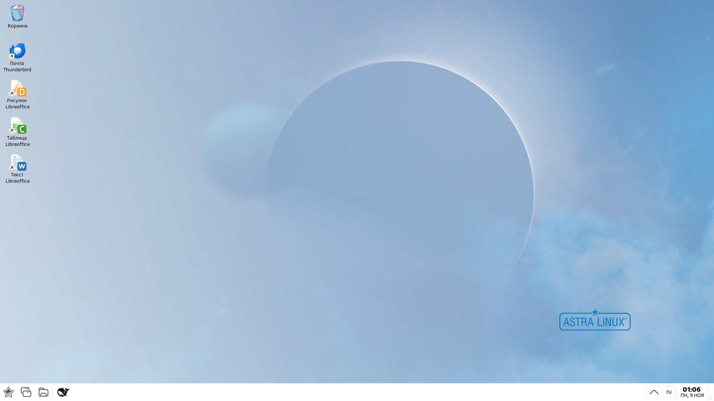
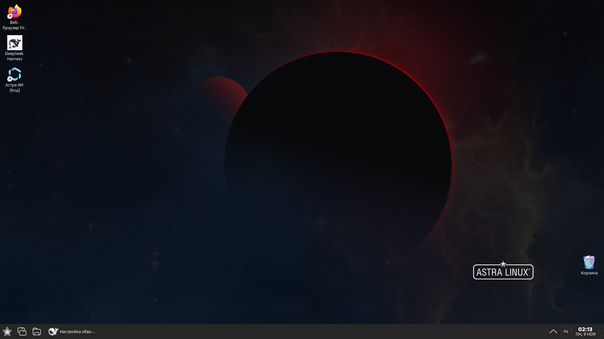

# Тема Fly «Astra 1.8 Fly Dark» + автосмена день/ночь

Тёмная тема оформления **Fly** для **Astra Linux 1.8** (Special Edition / Common
Edition, X11) и автоматическая смена темы по времени суток: днём — светлая
версия этой темы (светлые панель, меню и обои), ночью — тёмная тема.

**Шапка окна окрашена в цвет окна**: днём — белая с тёмным текстом, ночью —
тёмная (`#262626`) со светлым текстом. Толстая рамка отключена
(`FrameBorderWidth=0`).

При смене темы Fly не всегда перерисовывает 1 px кромку у верха окна и может
оставить полоску от прежней темы. Поэтому `fly-theme-apply` после переключения
«подталкивает» окна на 1 px и обратно — Fly перерисовывает шапку и кромки, окна
и фокус остаются на месте, перезапуск `fly-wm` не нужен.

Тема повторяет оформление рабочего стола, собранное при настройке Astra:
тёмная тема — тёмный интерфейс (меню, панель задач, диалоги), шапка и кромки
окон `#262626`, обои `fly-default-red.jpg`; светлая тема — светлые панель,
меню и обои, шапка окна белая с тёмным текстом. В обеих темах отключена
толстая рамка (`FrameBorderWidth=0`) и нет цветной окантовки окон.

## Скриншоты

| День (`Astra18FlyLight`) | Ночь (`Astra18FlyDark`) |
|---|---|
|  |  |

## Состав

- тёмная тема Fly `Astra18FlyDark` и светлая `Astra18FlyLight`
  (Id темы, `index.theme` + `theme/themerc`); в тёмной шапка `#262626`, в
  светлой — белая с тёмным текстом (в цвет окна);
- пользовательские цветовые схемы `Astra18FlyDark.colors` (шапка/рамки
  `38,38,38`) и `Astra18FlyLight.colors` (шапка/рамки `255,255,255`);
- `fly-theme-apply` — применить тему по Id (с обновлением кромок окон);
- `fly-theme-switch` — демон автосмены день/ночь и CLI;
- `fly-theme-x11` — вспомогательные X11/EWMH-операции (активное окно,
  геометрия, «подталкивание» окон);
- установка в профиль (`install.sh` / `uninstall.sh`) и сборка `.deb`.

## Требования

- Astra Linux 1.8 с рабочим столом **Fly** (X11);
- пакет `fly-admin-theme` (`fly-select-theme`, `fly-wmfunc`, `fly-admin-theme`);
- `python3`, `bash`;
- композитор: в Astra Linux Fly используется `compton` (пакет `picom`);
- светлая тема входит в комплект (`Astra18FlyLight`), штатная
  `AstraProximaLight` не требуется.

## Установка в профиль пользователя (без root)

```sh
git clone https://github.com/Xivilai73/astra-1.8-fly-theme.git
cd astra-1.8-fly-theme
./install.sh
```

Скрипт:

1. копирует темы в `~/.local/share/flythemes/Astra18FlyDark` и
   `~/.local/share/flythemes/Astra18FlyLight`;
2. копирует схемы в `~/.local/share/color-schemes/` (обе);
3. ставит `fly-theme-apply`, `fly-theme-switch` и `fly-theme-x11`
   в `~/.local/bin`;
4. создаёт конфиг `~/.config/fly-theme-switch.conf` (если его ещё нет);
5. добавляет автозапуск `~/.config/autostart/fly-theme-switch.desktop`;
6. сохраняет бэкап текущего оформления и применяет тему по текущему времени
   суток, запускает демон.

Скрипт идемпотентен: повторный запуск обновляет файлы темы/скриптов, не
перезаписывая конфиг и бэкап.

## Готовый пакет

Собранный пакет и контрольная сумма — в [GitHub Releases](https://github.com/Xivilai73/astra-1.8-fly-theme/releases/tag/v1.0.1):

- [astra-1.8-fly-theme_1.0.1-1_all.deb](https://github.com/Xivilai73/astra-1.8-fly-theme/releases/download/v1.0.1/astra-1.8-fly-theme_1.0.1-1_all.deb)
- [SHA256SUMS](https://github.com/Xivilai73/astra-1.8-fly-theme/releases/download/v1.0.1/SHA256SUMS)

```sh
sha256sum -c SHA256SUMS
sudo dpkg -i astra-1.8-fly-theme_1.0.1-1_all.deb
```

## Установка из .deb (системно)

```sh
make deb          # или ./build-deb.sh
sudo dpkg -i dist/astra-1.8-fly-theme_1.0.1-1_all.deb
sudo apt-get -f install
```

Пакет ставит тему в `/usr/share/flythemes`, схему в
`/usr/share/color-schemes`, скрипты в `/usr/bin`, демон — в
`/etc/xdg/autostart`. Тему из пакета можно выбрать в
«Параметры → Оформление → Темы» как «Astra 1.8 Fly Dark» или
«Astra 1.8 Fly Light».

> Пакет ставится системно (нужен root), но применяется к пользователю при входе
> в сеанс — через демон автосмены.

## Автосмена день/ночь

Конфиг — `~/.config/fly-theme-switch.conf`:

```ini
DAY_START=08:00
NIGHT_START=20:00
DAY_THEME=Astra18FlyLight
NIGHT_THEME=Astra18FlyDark
CHECK_INTERVAL=60
```

- `DAY_START..NIGHT_START` — день; если `DAY_START > NIGHT_START`, интервал
  считается переходящим через полночь;
- `DAY_THEME` / `NIGHT_THEME` — Id тем Fly (см. `fly-theme-apply --list`);
  можно указать и штатную `AstraProximaLight` — `fly-theme-apply` обновит
  кромки окон после переключения;
- проверка — раз в `CHECK_INTERVAL` секунд.

Демон запускается автоматически при входе в сеанс (автозапуск `.desktop`).
Тема меняется только при смене фазы: ручной выбор темы в течение дня/ночи не
перебивается до следующей границы.

### Команды

```sh
fly-theme-switch --status                 # фаза, текущая тема, статус демона
fly-theme-switch --apply day|night|auto   # применить тему фазы вручную
fly-theme-switch --apply Astra18FlyDark   # применить конкретную тему
fly-theme-switch --once                   # один тик автосмены
fly-theme-switch --daemon                 # запустить демон вручную
```

Журнал — `~/.local/state/fly-theme-switch/log`, состояние — `state` в том же
каталоге. Повторный запуск демона не создаёт второй экземпляр (`flock`).

### Ручное переключение тем

```sh
fly-theme-apply --list
fly-theme-apply Astra18FlyDark
fly-theme-apply Astra18FlyLight
```

`fly-theme-apply` использует штатную утилиту Fly `fly-select-theme`: цвета,
панель задач, меню, шапка окон и обои применяются на лету. Затем окна
«подталкиваются» на 1 px и обратно (`fly-theme-x11 nudge`), чтобы Fly
перерисовал кромку/шапку без перезапуска `fly-wm` — окна и фокус сохраняются.
Если `fly-select-theme` недоступна, используется резервный способ: запись
`~/.config/fly-admin-themerc` и `~/.fly/paletterc` плюс перезапуск `fly-wm`
(с восстановлением активного окна и развёрнутых окон).

## Как это работает

- Тема Fly — каталог `flythemes/<Id>` (`index.theme` + `theme/themerc`) и
  цветовая схема (`*.colors`). `fly-select-theme` копирует параметры темы в
  `~/.fly/theme/current.themerc`, обновляет палитру и применяет оформление.
- В themerc темы путь к схеме подставляется при установке (плейсхолдер
  `@SCHEME_PATH@`): в профиле — `~/.local/share/color-schemes/`, в пакете —
  `/usr/share/color-schemes/`.
- `fly-theme-switch` считает фазу по локальному времени, сравнивает с
  сохранённым состоянием и при смене фазы вызывает `fly-theme-apply`.

## Ограничения

- **Нет широкого края для изменения размера мышью**: в теме
  `FrameBorderWidth=0` (тонкая кромка 1 px, как в текущем оформлении). Чтобы
  вернуть классическую рамку, добавьте в
  `~/.local/share/flythemes/Astra18FlyDark/theme/themerc` строку
  `FrameBorderWidth=5` и переключите тему заново.
- Смена темы через Fly кратковременно перезапускает панель задач/меню
  (несколько секунд); открытые окна не закрываются.
- При переключении темы напрямую через `fly-select-theme` (не через
  `fly-theme-apply`) у верха окна может остаться 1 px полоска от прежней темы —
  используйте `fly-theme-apply <id>` или `fly-theme-switch --apply`, они
  обновляют кромки.
- Если нужная тема не установлена, переключение не произойдёт — запись об
  ошибке попадёт в журнал, останется текущая тема.
- Ручные изменения оформления через «Параметры» будут перезаписаны при
  следующей автосмене — для своих постоянных настроек правьте тему/конфиг.

## Удаление

```sh
./uninstall.sh
```

Скрипт останавливает демон, удаляет тему, схему, скрипты, автозапуск и конфиг,
затем восстанавливает оформление, сохранённое при установке.

## Структура репозитория

```
astra-1.8-fly-theme/
├── README.md
├── LICENSE                    # MIT
├── Makefile                   # install / uninstall / deb / clean
├── install.sh                 # установка в профиль
├── uninstall.sh
├── build-deb.sh
├── packaging/
│   ├── control
│   └── fly-theme-switch.desktop
├── src/
│   ├── themes/Astra18FlyDark/   # index.theme + theme/themerc
│   ├── themes/Astra18FlyLight/  # index.theme + theme/themerc
│   ├── colors/Astra18FlyDark.colors
│   ├── colors/Astra18FlyLight.colors
│   ├── fly-theme-apply
│   ├── fly-theme-switch
│   ├── fly-theme-x11
│   └── fly-theme-switch.conf
└── docs/screenshots/
```

## Лицензия

MIT, см. [LICENSE](LICENSE).
